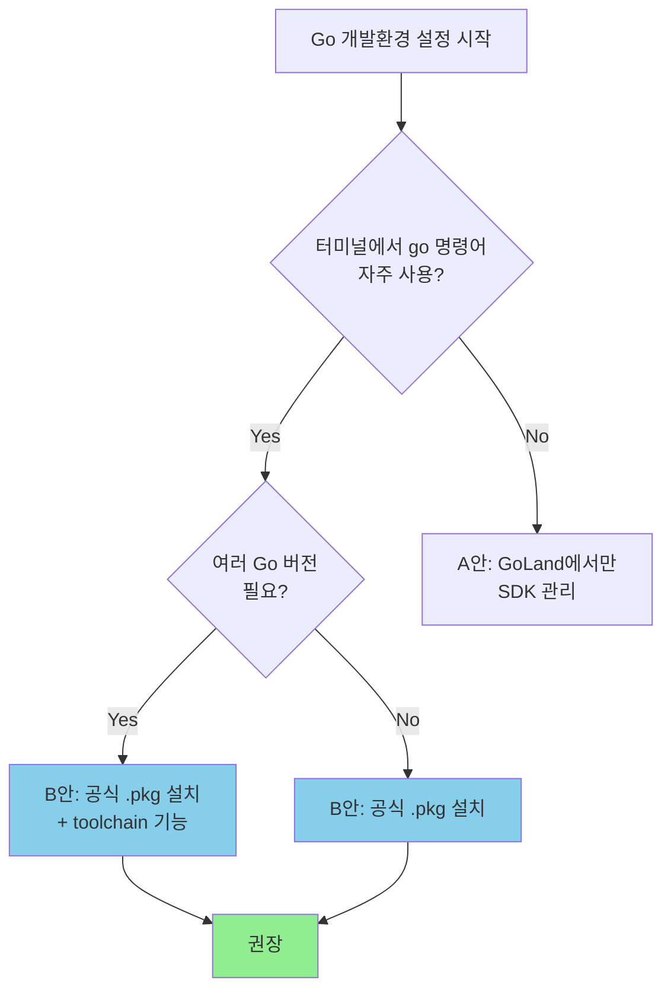
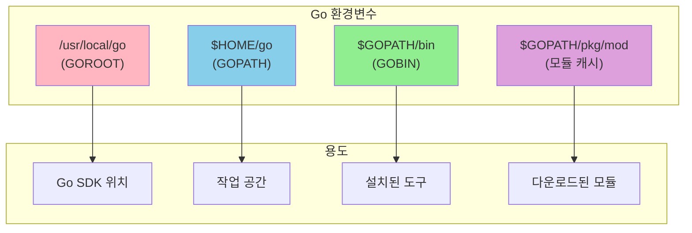
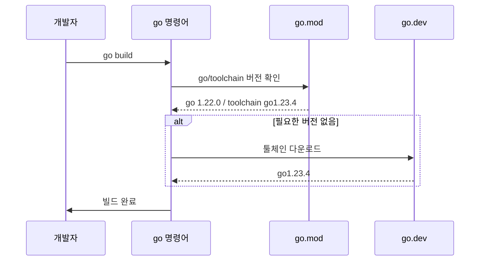

# macOS Go 개발환경 설정 가이드

> macOS + zsh + GoLand 환경에서 깔끔하고 유지보수 쉬운 Go 개발환경 구축하기

---

## 목차

1. [설치 방식 선택](#1-설치-방식-선택)
2. [Go SDK 설치](#2-go-sdk-설치)
3. [PATH 설정](#3-path-설정)
4. [환경변수 이해하기](#4-환경변수-이해하기)
5. [멀티 버전 관리](#5-멀티-버전-관리)
6. [GoLand 설정](#6-goland-설정)
7. [설치 검증](#7-설치-검증)
8. [자주 묻는 질문](#8-자주-묻는-질문)

---

## 1. 설치 방식 선택

### 의사결정 플로우차트



### 비교표

| 기준 | A안: GoLand만 | B안: 공식 .pkg 설치 |
|------|--------------|-------------------|
| 터미널 사용 | PATH 수동 설정 필요 | 바로 사용 가능 |
| 멀티 버전 | IDE에서만 전환 | `toolchain` 자동 전환 |
| CI/CD 일관성 | IDE 의존 | 시스템과 동일 |
| 설정 복잡도 | 낮음 | 낮음 |
| **권장 대상** | IDE만 사용하는 경우 | 대부분의 개발자 |

---

## 2. Go SDK 설치

### 방법 1: 터미널에서 설치 (권장)

```bash
# 1. 다운로드 (Apple Silicon)
curl -L -o /tmp/go1.25.6.darwin-arm64.pkg "https://go.dev/dl/go1.25.6.darwin-arm64.pkg"

# Intel Mac인 경우
# curl -L -o /tmp/go1.25.6.darwin-amd64.pkg "https://go.dev/dl/go1.25.6.darwin-amd64.pkg"

# 2. 설치 (sudo 비밀번호 필요)
sudo installer -pkg /tmp/go1.25.6.darwin-arm64.pkg -target /
```

### 방법 2: GUI로 설치

1. [https://go.dev/dl/](https://go.dev/dl/) 접속
2. macOS용 `.pkg` 파일 다운로드
3. 더블클릭하여 설치

### 설치 위치

```
/usr/local/go/          # GOROOT (Go SDK 설치 경로)
├── bin/
│   ├── go              # go 명령어
│   └── gofmt           # 포맷터
├── src/                # 표준 라이브러리 소스
└── pkg/                # 컴파일된 패키지
```

---

## 3. PATH 설정

### 설정 파일 선택

| 파일 | 적용 시점 | 권장 |
|------|----------|------|
| `~/.zprofile` | 로그인 시 | **권장** (예측 가능) |
| `~/.zshrc` | 터미널 열 때마다 | 인터랙티브 설정용 |

### 최소 설정 (권장)

```bash
# ~/.zprofile에 추가
export PATH="/usr/local/go/bin:$PATH"
```

### 적용

```bash
source ~/.zprofile
```

### 예시: ~/.zprofile 전체

```bash
eval "$(/opt/homebrew/bin/brew shellenv)"

# Go
export PATH="/usr/local/go/bin:$PATH"

# JetBrains Toolbox (있는 경우)
export PATH="$PATH:/Users/USERNAME/Library/Application Support/JetBrains/Toolbox/scripts"
```

---

## 4. 환경변수 이해하기

### 환경변수 관계도



### 상세 설명

| 변수 | 기본값 | 설명 | 설정 필요? |
|------|--------|------|-----------|
| `GOROOT` | `/usr/local/go` | Go SDK 설치 경로 | **No** (자동 감지) |
| `GOPATH` | `$HOME/go` | 워크스페이스 경로 | **No** (기본값 사용) |
| `GOBIN` | `$GOPATH/bin` | 바이너리 설치 경로 | 선택적 |
| `GOMODCACHE` | `$GOPATH/pkg/mod` | 모듈 캐시 경로 | **No** |

### 핵심 원칙

> **"가능하면 건드리지 않기"** - Go 공식 문서의 권장사항
>
> Go Modules가 표준이 된 지금, `GOPATH`와 `GOROOT`를 직접 설정할 필요가 거의 없습니다.

### (선택) GOBIN 분리 설정

Go 도구들을 별도 폴더로 관리하고 싶은 경우:

```bash
# 디렉터리 생성
mkdir -p "$HOME/.local/go/bin"

# GOBIN 설정 (영구 저장됨)
go env -w GOBIN="$HOME/.local/go/bin"

# ~/.zprofile에 PATH 추가
export PATH="$HOME/.local/go/bin:$PATH"
```

---

## 5. 멀티 버전 관리

### Go 1.21+ Toolchain 기능

Go 1.21부터 **자동 툴체인 관리** 기능이 내장되어, 프로젝트별로 다른 Go 버전을 자동으로 사용할 수 있습니다.



### go.mod 설정

```go
module myproject

go 1.22.0           // 최소 Go 버전 (언어 기능)
toolchain go1.23.4  // 실제 빌드에 사용할 버전
```

| 지시어 | 역할 | 영향 범위 |
|--------|------|----------|
| `go 1.22.0` | 최소 언어 버전 | 이 모듈을 사용하는 모든 곳 |
| `toolchain go1.23.4` | 빌드 툴체인 버전 | 이 모듈 개발 시에만 |

### 버전 관리 명령어

```bash
# 특정 버전으로 업그레이드
go get go@1.23.0
go get toolchain@1.23.4

# 환경변수로 강제 지정 (일시적)
GOTOOLCHAIN=go1.22.0 go build
```

### 장점

- Node.js의 `nvm`, Rust의 `rustup`과 유사하지만 **go 명령어에 내장**
- 별도 버전 관리자 설치 불필요
- 팀원 간 빌드 재현성 보장

---

## 6. GoLand 설정

### GOROOT 설정

1. **Settings** → **Go** → **GOROOT**
2. 자동 감지된 `/usr/local/go` 확인
3. 필요시 **Add SDK** → **Download**로 다른 버전 추가

### GOPATH 설정

1. **Settings** → **Go** → **GOPATH**
2. 기본값 `~/go` 사용 (변경 불필요)

### 프로젝트 초기화

```bash
# 새 프로젝트 생성 후
go mod init 프로젝트명
```

---

## 7. 설치 검증

### 체크리스트

```bash
# 1. Go 버전 확인
go version
# 예상 출력: go version go1.25.6 darwin/arm64

# 2. 환경변수 확인
go env GOPATH GOROOT GOBIN

# 예상 출력:
# /Users/USERNAME/go        (GOPATH - 기본값)
# /usr/local/go             (GOROOT)
# (비어있거나 설정한 경로)    (GOBIN)

# 3. 모듈 초기화 테스트
mkdir -p ~/test-go && cd ~/test-go
go mod init test
# 출력: go: creating new go.mod: module test

# 정리
cd ~ && rm -rf ~/test-go
```

### 정상 상태 요약

```
┌─────────────────────────────────────────────────────┐
│  Go 개발환경 정상 상태                               │
├─────────────────────────────────────────────────────┤
│  go version     → go1.25.6 darwin/arm64            │
│  GOROOT         → /usr/local/go                    │
│  GOPATH         → /Users/USERNAME/go (기본값)       │
│  GOBIN          → (미설정 = $GOPATH/bin 사용)       │
│  go mod init    → 정상 작동                         │
└─────────────────────────────────────────────────────┘
```

---

## 8. 자주 묻는 질문

### Q: Homebrew로 Go를 설치하면 안 되나요?

**권장하지 않습니다.** 이유:
- `brew upgrade`시 의도치 않게 버전이 변경될 수 있음
- 여러 버전 관리가 복잡해짐
- Go 내장 toolchain 기능과 충돌 가능성

### Q: GOPATH를 프로젝트 폴더로 설정해야 하나요?

**아니요.** Go Modules 도입 이후 GOPATH 외부 어디서든 프로젝트를 만들 수 있습니다.

```bash
# 이제 이렇게 해도 됨
mkdir ~/Projects/my-go-app
cd ~/Projects/my-go-app
go mod init my-go-app
```

### Q: 이전 버전 Go를 완전히 삭제하려면?

```bash
sudo rm -rf /usr/local/go
# ~/.zprofile에서 Go 관련 PATH 제거
```

### Q: go install로 설치한 도구는 어디에?

```bash
# 기본 위치 확인
go env GOBIN
# 비어있으면: $GOPATH/bin = ~/go/bin

# 예: golangci-lint 설치
go install github.com/golangci/golangci-lint/cmd/golangci-lint@latest
# 설치 위치: ~/go/bin/golangci-lint
```

---

## 참고 자료

- [Go 공식 설치 가이드](https://go.dev/doc/install)
- [Go Toolchains 공식 문서](https://go.dev/doc/toolchain)
- [Go Wiki: GOPATH](https://go.dev/wiki/GOPATH)
- [GoLand GOROOT/GOPATH 설정](https://www.jetbrains.com/help/go/configuring-goroot-and-gopath.html)
- [Forward Compatibility and Toolchain Management](https://go.dev/blog/toolchain)
- [DigitalOcean: macOS Go 설정 가이드](https://www.digitalocean.com/community/tutorials/how-to-install-go-and-set-up-a-local-programming-environment-on-macos)

---

## 빠른 설정 체크시트

```bash
# 1. 설치
curl -L -o /tmp/go.pkg "https://go.dev/dl/go1.25.6.darwin-arm64.pkg"
sudo installer -pkg /tmp/go.pkg -target /

# 2. PATH (~/.zprofile에 추가)
echo 'export PATH="/usr/local/go/bin:$PATH"' >> ~/.zprofile
source ~/.zprofile

# 3. 확인
go version
go env GOPATH GOROOT
```

---

*마지막 업데이트: 2026-01-30*